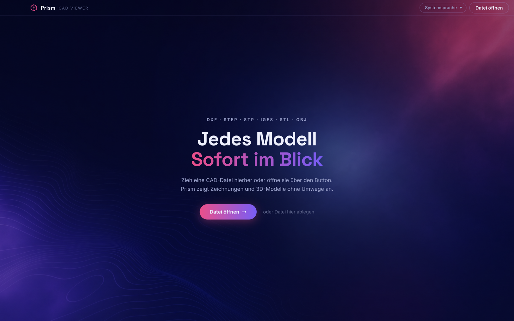
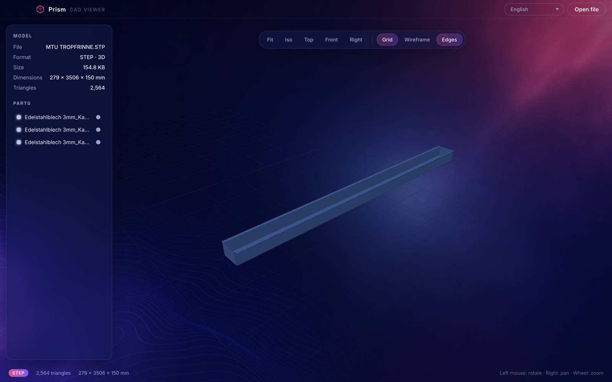

# Cubory - The modern CAD viewer

Desktop-Viewer für CAD-Dateien - für macOS, Windows und Linux. Öffnet
2D-Zeichnungen (DXF, DWG) und 3D-Modelle (STEP, IGES, STL, OBJ, 3MF, PLY, GLTF)
direkt lokal, ohne Server und ohne Internetverbindung.

Website und Downloads: [cubory.app](https://cubory.app)





## Unterstützte Formate

| Format | Typ | Parser |
|---|---|---|
| DXF | 2D-Zeichnung | `dxf` (JS) - Splines, Bögen, Bulge-Polylinien, Blöcke/INSERT |
| DWG | 2D-Zeichnung | LibreDWG (`dwg2dxf`, System-Installation) → DXF-Pipeline |
| STEP / STP | 3D-Volumenmodell | OpenCascade als WebAssembly (`occt-import-js`) |
| IGES / IGS | 3D | OpenCascade (WASM) |
| BREP | 3D | OpenCascade (WASM) |
| STL | 3D-Mesh | three.js STLLoader |
| OBJ | 3D-Mesh | three.js OBJLoader |
| 3MF | 3D-Mesh | three.js ThreeMFLoader, inklusive Production Extension |
| PLY | 3D-Mesh oder Punktwolke | three.js PLYLoader |
| GLTF / GLB | 3D-Szene | three.js GLTFLoader |

Zwei Eigenheiten, die in der Praxis zählen:

- **3MF aus Slicern** (Bambu Studio, PrusaSlicer, Orca) legt die Geometrie über
  die Production Extension in eigene `3D/Objects/*.model`-Dateien. three baut
  die Wurzeldatei zuerst und findet die Verweise dann noch nicht. `prepare3mf()`
  in `src/loaders.js` sortiert die Objektdateien im Archiv nach vorne - ohne das
  scheitert praktisch jeder Slicer-Export.
- **PLY ohne Flächen** stammt meist aus 3D-Scans und wird als Punktwolke
  gezeichnet. Als Mesh gerendert bliebe das Bild leer.

Nicht unterstützt sind native Formate wie SLDPRT, IPT, CATPart oder Parasolid -
die brauchen kommerziell lizenzierte Bibliotheken.

## Funktionen

Kostenlos und ohne Zeitlimit:

- Öffnen per Dialog, Drag & Drop oder Doppelklick im Finder/Explorer
  (Dateiverknüpfungen sind registriert)
- 3D: Drehen, Zoomen, Verschieben; Ansichten Iso/Oben/Vorne/Rechts; Drahtgitter,
  Kantenlinien, Raster
- 2D (DXF): Ebenen mit Original-Farben ein- und ausblenden. Zu dunkle Farben
  werden aufgehellt, ohne den Farbton zu verlieren - CAD-Dateien sind für weißes
  Papier gezeichnet und wären auf dem dunklen Hintergrund sonst unlesbar
- Baugruppen: Teileliste mit Original-Namen; Klick auf ein Teil isoliert es, der
  Punkt daneben blendet es ein/aus; doppelte Namen werden durchnummeriert
- Modell-Info: Abmessungen in mm, Elemente, Dreiecke oder Punkte, Dateigröße
- 20 Sprachen, Standard ist die Systemsprache
- Optionen: Autostart, zuletzt geöffnete Dateien wieder öffnen, Startanimation,
  anonyme Fehlerberichte, Sprache, Standardprogramm für Dateitypen,
  Update-Prüfung. Dazu auf Windows und Linux „Im Hintergrund weiterlaufen" -
  unter macOS ausgeblendet, weil dort das Schließen des Fensters die App
  ohnehin nicht beendet

Cubory Pro (7 Tage kostenlos bei jedem neuen Konto):

- Messen mit Einrasten auf Ecken und Kanten
- Schnittansichten entlang X, Y und Z
- Explosionsansichten für Baugruppen
- Export nach STL und SVG, HD-Screenshots

Läuft die Testphase ab, wechselt die App auf Free. Alle Formate, Ansichten und
Ebenen bleiben unbegrenzt nutzbar - gesperrt werden nur die Pro-Werkzeuge.

## Tastatur & Maus

| Eingabe | Aktion |
|---|---|
| `Cmd/Strg + O` | Datei öffnen |
| `F` | Ansicht einpassen |
| Linke Maustaste | Drehen (3D) / Verschieben (2D) |
| Rechte Maustaste | Verschieben |
| Mausrad | Zoom |

## Installation

Fertige Installer liegen nach dem Build in `release/`, aktuell in Version 1.5.3:

- `Cubory-1.5.3-arm64.dmg` - macOS (Apple Silicon)
- `Cubory-1.5.3.dmg` - macOS (Intel)
- `Cubory Setup 1.5.3.exe` - Windows (64-bit)
- `Cubory-1.5.3.AppImage` - Linux (x64)

Die Builds sind nicht code-signiert: macOS-Gatekeeper bzw. Windows SmartScreen
zeigen beim ersten Start eine Warnung, die sich über „Trotzdem öffnen"
bestätigen lässt. Automatische Updates laufen über electron-updater gegen
`https://cubory.app/downloads`; auf macOS greift mangels Signatur ein manueller
Hinweis statt der stillen Installation.

## Entwicklung

Voraussetzung: Node.js ≥ 22.

```bash
npm install
npm start          # Renderer bauen + Electron starten
npm run dev        # Vite-Devserver (Renderer im Browser, ohne Electron-APIs)
```

### Tests

```bash
npm test           # Unit-Tests, laufen in unter einer Sekunde
npm run test:watch # dieselben Tests im Watch-Modus
npm run test:e2e   # Rauchtest: startet die gebaute App über Playwright
```

| Datei | Prüft |
|---|---|
| `test/loaders.test.js` | Jedes Format über `loadCadFile()`, STEP über den echten OpenCascade-Kern, inklusive der Regressionen: DXF aus LibreDWG mit fehlendem Gruppencode, 3MF mit Production Extension, aufgehelltes Blau, das nicht ins Violette kippt, und die Schattierung (flach, wo die Datei keine Normalen mitbringt) |
| `test/formats.test.js` | Die fünf Stellen mit Formatlisten (Loader, erlaubte Endungen, Dateidialog, Dateizuordnungen, Website) stimmen überein |
| `test/i18n.test.js` | Alle 20 Sprachen haben dieselben Schlüssel und behalten ihre Platzhalter |
| `test/website.test.js` | Feed-Auswertung inklusive Dateinamen mit Leerzeichen, interne Links und Sprungmarken |
| `test/e2e/app.e2e.test.js` | App startet, Renderer bekommt sein CSS, eine Datei pro Format läuft bis zur Statusanzeige durch |

Testdateien liegen nicht als Binärdateien im Repo, sondern werden in
`test/fixtures.js` erzeugt - neben jeder steht, welchen Fehlerfall sie abbildet.

Wer einen Regressionstest ändert, sollte einmal die zugehörige Korrektur im
Quelltext entfernen und prüfen, dass genau dieser Test rot wird. Ein Test, der
auch ohne den Fix besteht, schützt vor nichts.

### Installer bauen

```bash
npm run dist       # macOS + Windows + Linux
npm run dist:mac   # nur DMG (arm64 + x64)
npm run dist:win   # nur NSIS-Installer (x64)
npm run dist:linux # nur AppImage (x64)
```

### Ausliefern

`dev` ist der Arbeitsbranch, `main` der Auslieferungsstand. Beim Merge nach
`main` baut GitHub Actions die Installer, lädt sie auf den Server und bringt
Website und API auf denselben Stand. Details und die einmalige Servereinrichtung
stehen in [docs/deployment.md](docs/deployment.md).

Ohne erhöhte Version in `package.json` bekommen bestehende Installationen kein
Update - die Pipeline lädt trotzdem hoch und schreibt eine Warnung in die
Job-Zusammenfassung.

## Sprachen

Die UI gibt es in 20 Sprachen: en, de, fr, es, it, pt, nl, pl, sv, da, no, fi,
cs, sk, hu, ro, el, bg, hr, uk. Standard ist die Systemsprache; die Auswahl wird
lokal gespeichert.

Englisch (`src/strings/en.js`) ist die Quelle, Deutsch (`src/strings/de.js`) ist
handgepflegt. Alle anderen Sprachdateien werden lokal mit Ollama und
`mistral-small` generiert:

```bash
ollama serve                                 # falls nicht schon aktiv
node scripts/translate-locales.mjs           # alle Sprachen, nur fehlende Schlüssel
node scripts/translate-locales.mjs fr        # einzelne Sprache
node scripts/translate-locales.mjs --rework  # Review-Durchlauf über alle Übersetzungen
```

Das Skript ist idempotent, validiert Platzhalter wie `{n}` und fällt bei
fehlenden Schlüsseln auf Englisch zurück. `npm test` prüft zusätzlich, dass
keine Sprache Schlüssel oder Platzhalter verloren hat.

## Projektstruktur

```
electron/          Hauptprozess (main.cjs) und Preload-Bridge (preload.cjs)
src/main.js        UI-Logik, Datei öffnen, Sprachumschalter
src/viewer.js      three.js-Szene: Kamera, Licht, Raster, Ansichten, Teil-Isolation
src/loaders.js     Import aller Formate
src/proFeatures.js Messen, Schnitt, Explosion, Export
src/i18n.js        Sprachauswahl und t()-Funktion
src/strings/       en.js (Quelle), de.js (handgepflegt), Rest generiert
backend/           Go/Gin-API: Konten, Lizenzen, Billing, E-Mail
website/           Marketingseite (de und en), Kundenportal, Admin, Rechtstexte
test/              Unit-Tests und Rauchtest, Fixtures im Code erzeugt
deploy/            Servereinrichtung und API-Rollout mit Rollback
.github/workflows/ CI und Auslieferung
scripts/           translate-locales.mjs (Ollama), build-en.mjs, build-guides.mjs
docs/              Screenshots, Deployment, Lizenz-Architektur
release/           fertige Installer (nach npm run dist)
```

## Lizenz-System

Architektur: [docs/licensing-architecture.md](docs/licensing-architecture.md).
Umgesetzt: Go/Gin-Backend (`backend/`), Electron-Integration, Kundenportal und
Admin-Backend (`website/portal/`, `website/admin/`).

- **Konten & Trial**: Registrierung mit E-Mail-Bestätigung per Code, danach
  7 Tage Cubory Pro (nicht zurücksetzbar), anschließend automatisch Free
- **Lizenzen**: Trial / Free / Pro (monthly, yearly, lifetime); Entitlements als
  Daten, die App fragt nur `can('export')`
- **Offline**: Ed25519-signierte Lizenz-Tokens mit rollierendem 30-Tage-Fenster,
  gerätegebunden; Schutz gegen Zurückstellen der Uhr
- **Geräte**: Limit pro Plan, Verwaltung in App und Portal
- **Billing**: Paddle hinter einem `BillingProvider`-Interface (Dev-Provider
  ohne Keys, Stripe-Implementierung liegt weiterhin bei), Webhooks idempotent
- **E-Mails**: Bestätigungscode, Willkommen, Passwort zurücksetzen, Trial-Ende -
  als HTML im App-Design mit Textfassung im selben Versand

```bash
cd backend
make db-create   # PostgreSQL-Datenbanken anlegen (einmalig)
make run         # API auf :8880 (Migrationen laufen automatisch)
make test        # Tests gegen cubory_test
```

Die App verbindet sich per `CUBORY_API_URL` (Default: https://api.cubory.app).
Paddle wird über `PADDLE_API_KEY`, `PADDLE_WEBHOOK_SECRET` und
`PADDLE_PRICE_MONTHLY|YEARLY|LIFETIME` aktiviert; SMTP über `CUBORY_SMTP_*`.
Für Produktion sind `CUBORY_JWT_SECRET` und `CUBORY_LICENSE_SIGNING_SEED`
Pflicht; der zugehörige Public Key muss in
`electron/services/accountManager.cjs` eingetragen werden.

## Technik

Electron + Vite, three.js für die Darstellung, OpenCascade (WASM) für
STEP/IGES/BREP, das `dxf`-npm-Paket für DXF. Hintergrundbild und App-Icon wurden
mit Higgsfield generiert. Für automatisierte Tests lädt der Hook
`window.__openPath(pfad)` eine Datei; mit der Umgebungsvariable
`CUBORY_TEST_USERDATA` nutzt eine Test-Instanz ein eigenes Profil und kollidiert
nicht mit einer laufenden App.
