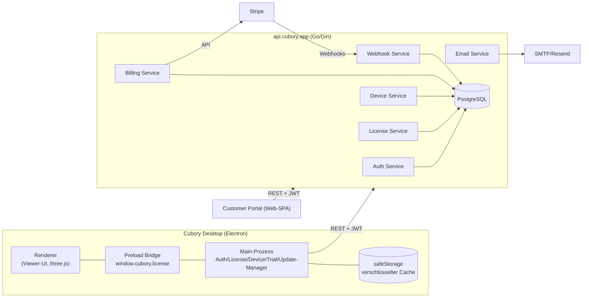
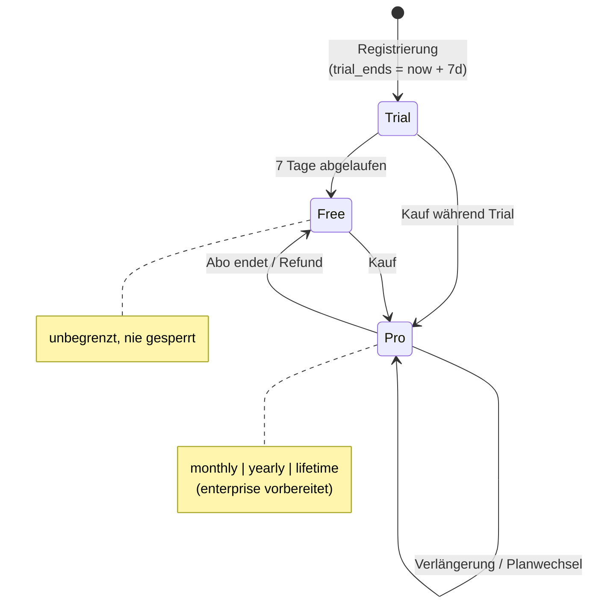

# Cubory - Lizenz-, Account- & Payment-Architektur

Stand: 2026-07-18 · Status: Entwurf zur Umsetzung

Dieses Dokument beschreibt das komplette Lizenz-, Auth-, Abo- und Zahlungssystem
für Cubory. Leitbild: das WinRAR-Modell, aber modern - die App wird **nie**
unbenutzbar, Free bleibt dauerhaft stark, Pro überzeugt über Features statt
über Druck.

---

## 0. Architektur-Entscheidungen (mit Begründung)

| # | Entscheidung | Begründung |
|---|---|---|
| 1 | **Desktop bleibt Electron** | Die bestehende App (Vite + three.js + occt-import-js/WASM) läuft produktiv in Electron. Ein Wails-Port würde den kompletten Renderer-Stack riskieren, ohne Nutzen fürs Lizenzsystem. Alle Manager laufen im **Main-Prozess (TypeScript)**, der Renderer bekommt nur eine schmale, read-only Preload-API. |
| 2 | **Backend: Go + Gin + PostgreSQL** | Wie spezifiziert. Ein einzelnes, stateless deploybares Binary; horizontale Skalierung hinter einem Load Balancer. |
| 3 | **Server ist die einzige Wahrheit** | Trial-Daten, Lizenzstatus und Entitlements leben ausschließlich serverseitig. Der Client cached nur ein **signiertes Lizenz-Token** (Ed25519). Lokales Löschen/Manipulieren kann daher nie einen Trial zurücksetzen oder Pro freischalten. |
| 4 | **Signierte Lizenz-Tokens statt Online-Zwang** | Der Server stellt bei jeder Validierung ein Ed25519-signiertes Token mit `valid_until = now + 30 Tage` aus. Der Client prüft die Signatur mit dem einkompilierten Public Key. Damit funktioniert Offline-Betrieb 30 Tage ohne Server-Roundtrip - und ohne dass der Client der lokalen Uhr allein vertrauen muss (siehe §6.4 Clock-Tamper-Schutz). |
| 5 | **Entitlements als Daten, nicht als Code** | Features fragen `license.can('measurements')`. Die Zuordnung Plan→Entitlements liegt in DB-Tabellen und im signierten Token. Neue Pläne (Enterprise) = neue Zeilen, kein Code-Umbau. |
| 6 | **Billing hinter Interface** | `BillingProvider`-Interface (CreateCheckout, CreatePortalSession, CancelSubscription, …) mit `StripeProvider` als erster Implementierung. Stripe-Typen tauchen ausschließlich im Provider-Package und im Webhook-Parser auf. |
| 7 | **Customer Portal als separate Web-App** | Schmales SPA (gleiche Design-Sprache wie die App) gegen dieselbe REST-API. Rechnungen, Zahlungsmethode und Steuer-Handling delegieren wir an das Stripe Customer Portal - weniger PCI-Fläche, schneller live. |
| 8 | **Keine harte Abschaltung, nirgends** | Jeder Fehlerpfad (Trial abgelaufen, Abo gekündigt, 30 Tage offline) degradiert auf **Free**, nie auf „gesperrt". |

---

## 1. Systemüberblick



Drei Deployables:

1. **`cubory-api`** - Go-Binary (Gin), stateless, hinter TLS/Load Balancer
2. **Customer Portal** - statisches SPA (portal.cubory.app)
3. **Desktop-App** - bestehende Electron-App + neue Main-Prozess-Manager

---

## 2. Lizenzmodell

### 2.1 Zustände



- **Trial**: startet automatisch bei Registrierung, exakt einmal pro Account.
  `trial_started_at` wird serverseitig gesetzt und nie wieder verändert.
  Während des Trials gelten die Pro-Entitlements.
- **Free**: Ergebnis eines abgelaufenen Trials oder beendeten Abos. Voll
  benutzbar (alle Formate, Zoom/Rotate/Pan, Objektbaum, Eigenschaften,
  Dark/Light Mode). Unbegrenzt.
- **Pro**: `monthly`, `yearly` (Stripe Subscriptions) oder `lifetime`
  (einmalige Zahlung, `expires_at = NULL`). `enterprise` ist als Plan-Zeile
  vorbereitet (eigene Entitlements, z. B. `sso`, höheres Geräte-Limit).

### 2.2 Entitlements

| Key | Free | Pro | Beschreibung |
|---|---|---|---|
| `measurements` | - | ✓ | Messwerkzeuge |
| `section_views` | - | ✓ | Schnittansichten |
| `exploded_views` | - | ✓ | Explosionsansichten |
| `export` | - | ✓ | Export (STEP/STL/…) |
| `batch` | - | ✓ | Batch-Export |
| `hires_screenshot` | - | ✓ | Hochauflösende Screenshots |
| `annotations` | - | ✓ | Anmerkungswerkzeuge |
| `commercial` | - | ✓ | Kommerzielle Nutzung |
| `cloud` | - | ✓ | zukünftige Cloud-Features |

Die Tabelle ist Daten (§4, `plans` / `plan_entitlements`); der Client kennt nur
`license.can(key)`.

---

## 3. Datenbankschema (PostgreSQL)

Normalisiert, UUIDs überall (`gen_random_uuid()`), `timestamptz` für alle
Zeitstempel. Migrationen via `golang-migrate`.

```sql
-- ── Nutzer ────────────────────────────────────────────────────────────────
CREATE TABLE users (
  id                 uuid PRIMARY KEY DEFAULT gen_random_uuid(),
  email              citext UNIQUE NOT NULL,
  email_verified_at  timestamptz,
  password_hash      text NOT NULL,               -- argon2id
  name               text NOT NULL,
  trial_started_at   timestamptz NOT NULL DEFAULT now(),
  trial_ends_at      timestamptz NOT NULL,        -- trial_started_at + 7d
  created_at         timestamptz NOT NULL DEFAULT now(),
  last_login_at      timestamptz,
  deleted_at         timestamptz                  -- Soft Delete (DSGVO-Export separat)
);

-- ── Pläne & Entitlements (Daten statt Code) ───────────────────────────────
CREATE TABLE plans (
  id           text PRIMARY KEY,                  -- 'free' | 'pro' | 'enterprise'
  name         text NOT NULL,
  max_devices  int  NOT NULL DEFAULT 3
);

CREATE TABLE entitlements (
  key         text PRIMARY KEY,                   -- 'measurements', 'export', …
  description text NOT NULL
);

CREATE TABLE plan_entitlements (
  plan_id         text NOT NULL REFERENCES plans(id),
  entitlement_key text NOT NULL REFERENCES entitlements(key),
  PRIMARY KEY (plan_id, entitlement_key)
);

-- ── Lizenzen (eine aktive pro User) ───────────────────────────────────────
CREATE TYPE license_kind AS ENUM ('trial','free','monthly','yearly','lifetime','enterprise');

CREATE TABLE licenses (
  id            uuid PRIMARY KEY DEFAULT gen_random_uuid(),
  user_id       uuid NOT NULL REFERENCES users(id),
  plan_id       text NOT NULL REFERENCES plans(id),
  kind          license_kind NOT NULL,
  status        text NOT NULL DEFAULT 'active',   -- active | past_due | cancelled | expired
  starts_at     timestamptz NOT NULL DEFAULT now(),
  expires_at    timestamptz,                      -- NULL = lifetime/free
  created_at    timestamptz NOT NULL DEFAULT now(),
  updated_at    timestamptz NOT NULL DEFAULT now()
);
CREATE UNIQUE INDEX one_active_license_per_user
  ON licenses(user_id) WHERE status = 'active';

-- ── Abos & Zahlungen (Provider-agnostisch, Stripe-IDs als Referenz) ───────
CREATE TABLE subscriptions (
  id                     uuid PRIMARY KEY DEFAULT gen_random_uuid(),
  user_id                uuid NOT NULL REFERENCES users(id),
  license_id             uuid NOT NULL REFERENCES licenses(id),
  provider               text NOT NULL DEFAULT 'stripe',
  provider_customer_id   text NOT NULL,
  provider_subscription_id text UNIQUE,
  interval               text NOT NULL,           -- month | year
  status                 text NOT NULL,           -- active | past_due | cancelled | resumed
  cancel_at_period_end   boolean NOT NULL DEFAULT false,
  current_period_end     timestamptz,
  created_at             timestamptz NOT NULL DEFAULT now(),
  updated_at             timestamptz NOT NULL DEFAULT now()
);

CREATE TABLE payments (
  id                   uuid PRIMARY KEY DEFAULT gen_random_uuid(),
  user_id              uuid NOT NULL REFERENCES users(id),
  subscription_id      uuid REFERENCES subscriptions(id),  -- NULL bei Lifetime
  provider             text NOT NULL DEFAULT 'stripe',
  provider_payment_id  text UNIQUE NOT NULL,
  amount_cents         int NOT NULL,
  currency             text NOT NULL,
  status               text NOT NULL,             -- succeeded | failed | refunded
  paid_at              timestamptz,
  created_at           timestamptz NOT NULL DEFAULT now()
);

CREATE TABLE invoices (
  id                   uuid PRIMARY KEY DEFAULT gen_random_uuid(),
  user_id              uuid NOT NULL REFERENCES users(id),
  payment_id           uuid REFERENCES payments(id),
  provider_invoice_id  text UNIQUE NOT NULL,
  number               text NOT NULL,
  pdf_url              text,
  amount_cents         int NOT NULL,
  currency             text NOT NULL,
  issued_at            timestamptz NOT NULL
);

-- ── Geräte ────────────────────────────────────────────────────────────────
CREATE TABLE devices (
  id                   uuid PRIMARY KEY DEFAULT gen_random_uuid(),
  user_id              uuid NOT NULL REFERENCES users(id),
  name                 text NOT NULL,             -- Computername
  os                   text NOT NULL,             -- 'macOS 15.2', 'Windows 11', …
  fingerprint_hash     text NOT NULL,             -- SHA-256 des HW-Fingerprints
  app_version          text NOT NULL,
  activated_at         timestamptz NOT NULL DEFAULT now(),
  last_seen_at         timestamptz NOT NULL DEFAULT now(),
  deactivated_at       timestamptz,               -- NULL = aktiv
  UNIQUE (user_id, fingerprint_hash)
);
CREATE INDEX devices_fingerprint_idx ON devices(fingerprint_hash);  -- Trial-Farming-Signal

-- ── Sessions & Refresh-Tokens (Rotation + Reuse-Detection) ────────────────
CREATE TABLE sessions (
  id           uuid PRIMARY KEY DEFAULT gen_random_uuid(),
  user_id      uuid NOT NULL REFERENCES users(id),
  device_id    uuid REFERENCES devices(id),       -- NULL = Portal-Session
  ip           inet,
  user_agent   text,
  created_at   timestamptz NOT NULL DEFAULT now(),
  revoked_at   timestamptz
);

CREATE TABLE refresh_tokens (
  id           uuid PRIMARY KEY DEFAULT gen_random_uuid(),
  session_id   uuid NOT NULL REFERENCES sessions(id),
  token_hash   text UNIQUE NOT NULL,              -- SHA-256, nie Klartext
  family_id    uuid NOT NULL,                     -- Rotationskette
  expires_at   timestamptz NOT NULL,
  used_at      timestamptz,                       -- gesetzt = rotiert; erneute Nutzung → Familie sperren
  created_at   timestamptz NOT NULL DEFAULT now()
);

-- ── E-Mail-Flows ──────────────────────────────────────────────────────────
CREATE TABLE email_tokens (
  id          uuid PRIMARY KEY DEFAULT gen_random_uuid(),
  user_id     uuid NOT NULL REFERENCES users(id),
  purpose     text NOT NULL,                      -- verify_email | reset_password
  token_hash  text UNIQUE NOT NULL,
  expires_at  timestamptz NOT NULL,
  used_at     timestamptz
);

-- ── Webhooks (Idempotenz) & Audit ─────────────────────────────────────────
CREATE TABLE webhook_events (
  id                uuid PRIMARY KEY DEFAULT gen_random_uuid(),
  provider          text NOT NULL DEFAULT 'stripe',
  provider_event_id text UNIQUE NOT NULL,         -- doppelte Zustellung → no-op
  type              text NOT NULL,
  payload           jsonb NOT NULL,
  processed_at      timestamptz,
  error             text,
  received_at       timestamptz NOT NULL DEFAULT now()
);

CREATE TABLE audit_logs (
  id          uuid PRIMARY KEY DEFAULT gen_random_uuid(),
  user_id     uuid REFERENCES users(id),
  actor       text NOT NULL,                      -- 'user' | 'system' | 'webhook' | 'admin'
  action      text NOT NULL,                      -- 'login', 'trial_started', 'device_deactivated', …
  detail      jsonb,
  ip          inet,
  created_at  timestamptz NOT NULL DEFAULT now()
);
CREATE INDEX audit_user_idx ON audit_logs(user_id, created_at DESC);
```

Seed: `plans` (`free` max_devices 2, `pro` max_devices 3, `enterprise`
max_devices 25 - konfigurierbar), `entitlements` (§2.2), `plan_entitlements`
(alle Keys → `pro` und `enterprise`).

---

## 4. REST-API-Spezifikation

Basis: `https://api.cubory.app/api` · JSON · Fehlerformat einheitlich:

```json
{ "error": { "code": "trial_expired", "message": "…", "request_id": "uuid" } }
```

### 4.1 Auth

| Endpoint | Body → Antwort | Hinweise |
|---|---|---|
| `POST /auth/register` | `{name,email,password}` → `201 {user, tokens}` | legt Trial an (`trial_ends_at = now+7d`), sendet Verifizierungsmail; Rate-Limit 5/h/IP |
| `POST /auth/login` | `{email,password,device?}` → `{user, tokens}` | `device` (Name/OS/Fingerprint) registriert/aktualisiert das Gerät; generische Fehlermeldung bei falschen Credentials |
| `POST /auth/logout` | `{refresh_token}` → `204` | revoked Session |
| `POST /auth/refresh` | `{refresh_token}` → `{tokens}` | Rotation; Reuse eines alten Tokens sperrt die ganze Familie |
| `POST /auth/forgot-password` | `{email}` → `202` | immer 202 (kein User-Enumeration-Leak) |
| `POST /auth/reset-password` | `{token,password}` → `204` | revoked alle Sessions |
| `POST /auth/verify-email` | `{token}` → `204` | |

`tokens = { access_token (JWT, 15 min), refresh_token (opaque, 30 Tage), expires_in }`

### 4.2 License

| Endpoint | Beschreibung |
|---|---|
| `GET /license/status` | Voller Status: Plan, Kind, Trial-Rest, Ablauf, Entitlements, Geräte-Limit |
| `POST /license/activate` | Bindet dieses Gerät (Fingerprint) an den Account; prüft `max_devices`; Antwort enthält das **signierte Lizenz-Token** |
| `POST /license/deactivate` | Gibt den Geräte-Slot frei |
| `POST /license/heartbeat` | Täglicher Check-in: aktualisiert `last_seen_at`, liefert frisches signiertes Token. Body: `{app_version}` |

Antwort von `activate`/`heartbeat`:

```json
{
  "license_token": "<base64(payload)>.<base64(ed25519_sig)>",
  "status": { "plan": "pro", "kind": "yearly", "expires_at": "2027-07-18T…", "entitlements": ["measurements", "…"] }
}
```

### 4.3 Devices

| Endpoint | Beschreibung |
|---|---|
| `GET /devices` | Liste aktiver Geräte (Name, OS, zuletzt gesehen, App-Version, `current: true` fürs anfragende Gerät) |
| `DELETE /devices/{id}` | Deaktiviert ein Gerät (auch das aktuelle → App fällt bei nächstem Heartbeat auf Login zurück) |

### 4.4 Billing

| Endpoint | Beschreibung |
|---|---|
| `GET /subscription` | Aktueller Abo-Zustand inkl. `cancel_at_period_end`, `current_period_end`, Rechnungsliste |
| `POST /subscription/create` | `{plan: "monthly"\|"yearly"\|"lifetime"}` → `{checkout_url}` (Stripe Checkout) |
| `POST /subscription/cancel` | Kündigt zum Periodenende (`cancel_at_period_end = true`) |
| `POST /subscription/resume` | Nimmt Kündigung zurück |
| `GET /billing/portal` | → `{portal_url}` (Stripe Customer Portal: Zahlungsmethode, Rechnungen, Steuerdaten) |
| `POST /webhooks/stripe` | Signaturgeprüft (`Stripe-Signature`), idempotent über `webhook_events` |

**Webhook-Mapping** (Stripe-Event → Domänen-Aktion):

| Stripe-Event | Aktion |
|---|---|
| `checkout.session.completed` (lifetime) | `licenses`: kind=lifetime, expires_at=NULL; Payment anlegen |
| `customer.subscription.created` | Lizenz auf monthly/yearly, `expires_at = period_end + 3d Kulanz` |
| `invoice.paid` (`payment_succeeded`) | Payment+Invoice anlegen, `expires_at` fortschreiben |
| `invoice.payment_failed` (`payment_failed`) | Lizenz `past_due` (Pro bleibt bis Periodenende aktiv), Mail |
| `customer.subscription.updated` | Planwechsel/`cancel_at_period_end` synchronisieren |
| `customer.subscription.deleted` (`cancelled`) | Lizenz `expired` → User wird Free |
| Kündigung zurückgenommen (`resumed`) | Status zurück auf `active` |
| `charge.refunded` (`refund`) | Payment `refunded`; bei Lifetime-Refund Lizenz beenden |

---

## 5. Signiertes Lizenz-Token (Kern des Offline-Modells)

Payload (JSON, kanonisch serialisiert), signiert mit **Ed25519** (Private Key
nur auf dem Server, Public Key in die App einkompiliert):

```json
{
  "v": 1,
  "user_id": "uuid",
  "device_id": "uuid",
  "fingerprint_hash": "sha256:…",
  "plan": "pro",
  "kind": "yearly",
  "entitlements": ["measurements","section_views","exploded_views","export","batch","hires_screenshot","annotations","commercial"],
  "license_expires_at": "2027-07-18T00:00:00Z",
  "issued_at": "2026-07-18T10:00:00Z",
  "valid_until": "2026-08-17T10:00:00Z"
}
```

- `valid_until = issued_at + 30 Tage` → das ist die Offline-Karenz.
- Client prüft: Signatur gültig **und** `fingerprint_hash` passt zum Gerät
  **und** `now < valid_until`.
- Jeder erfolgreiche Heartbeat ersetzt das Token → die 30 Tage rollen.

---

## 6. Desktop-Integration (Electron)

### 6.1 Struktur (Main-Prozess, TypeScript)

```
electron/
  main.ts
  preload.ts
  services/
    http.ts                 # API-Client (fetch, Retry, Timeouts, Request-IDs)
    secureStore.ts          # safeStorage-verschlüsselte JSON-Datei im userData
    fingerprint.ts          # HW-Fingerprint (§6.3)
    authManager.ts          # Login/Logout/Refresh, Token-Lifecycle
    licenseManager.ts       # Token-Cache, Verify, can(), Statusübergänge
    trialManager.ts         # nur Anzeige-Logik (Resttage) - Wahrheit liegt beim Server
    deviceManager.ts        # activate/deactivate/list
    paymentManager.ts       # öffnet Checkout/Portal im Browser (shell.openExternal)
    updateManager.ts        # electron-updater (bestehend)
    upgradeNudge.ts         # Free-Dialog, max. 1×/24 h (§6.5)
```

Alle Manager sind Klassen mit Konstruktor-Injection (`new LicenseManager(http,
store, fingerprint)`) - testbar ohne Electron.

### 6.2 Preload-API (Renderer sieht nur das Nötigste)

```ts
contextBridge.exposeInMainWorld('cubory', {
  // … bestehende Viewer-API …
  account: {
    state: () => ipcRenderer.invoke('account:state'),      // {user, plan, kind, trialDaysLeft, expiresAt, devices}
    login: (email, password) => ipcRenderer.invoke('account:login', …),
    logout: () => ipcRenderer.invoke('account:logout'),
    openPortal: () => ipcRenderer.invoke('account:portal'),
    openCheckout: (plan) => ipcRenderer.invoke('account:checkout', plan),
    deactivateDevice: (id) => ipcRenderer.invoke('account:deactivateDevice', id),
  },
  license: {
    can: (key: string) => ipcRenderer.invoke('license:can', key),  // sync-Cache im Renderer gespiegelt
    onChange: (cb) => ipcRenderer.on('license:changed', cb),
  },
});
```

Der Renderer erhält beim Start und bei jeder Änderung ein Event
`license:changed` mit dem Entitlement-Set → UI blendet Pro-Buttons mit
Schloss-Badge ein/aus. **Durchsetzung** passiert zusätzlich im Main-Prozess:
IPC-Handler für Pro-Aktionen (z. B. `export:run`) prüfen selbst
`licenseManager.can('export')` - der Renderer ist nie die letzte Instanz.

### 6.3 Hardware-Fingerprint

`sha256(machineId + platform + arch)` über `node-machine-id`
(macOS: IOPlatformUUID, Windows: MachineGuid, Linux: /etc/machine-id).
Kein Auslesen von Seriennummern, keine PII; nur der Hash verlässt das Gerät.

### 6.4 Validierungs-Ablauf & Uhr-Manipulation

```
Start ──> Token aus secureStore lesen
   ├─ kein Token ────────────────→ Login-Flow (oder anonym = Free ohne Account)
   ├─ Signatur/Fingerprint falsch → Token verwerfen → Free + Login-Hinweis
   ├─ now > valid_until ─────────→ Free-Modus + Banner „Bitte online verifizieren"
   └─ gültig → Entitlements laden, im Hintergrund Heartbeat versuchen
                 ├─ Erfolg → frisches Token speichern
                 └─ offline → still weiter (Karenz läuft)
Heartbeat zusätzlich alle 24 h (Timer) und bei jedem Login.
```

Clock-Tampering: `secureStore` merkt sich `last_seen_wallclock`. Springt die
Systemuhr **rückwärts** hinter diesen Wert, gilt das Token als abgelaufen bis
zum nächsten erfolgreichen Server-Kontakt. (Vorwärtsstellen schadet dem Nutzer
nur selbst.)

Abgelaufene Karenz zeigt genau einen dezenten Banner:
*„Deine Lizenz konnte nicht überprüft werden. Bitte stelle eine
Internetverbindung her."* - die App läuft als Free weiter, Pro-Features sind
bis zur nächsten erfolgreichen Validierung gesperrt.

### 6.5 Free-Dialog (Upgrade-Nudge)

- Erscheint nur im Zustand Free, nur beim App-Start, **maximal 1× pro 24 h**
  (`lastNudgeAt` im secureStore), nie modal-blockierend während der Arbeit.
- Design: Glass-Card im bestehenden Cubory-Look (Navy, Magenta→Violett-Verlauf,
  `Space Grotesk`), Häkchenliste (Measurements, Section Views, Exploded Views,
  Unlimited Export, Professional Features), Buttons **„Continue Free"**
  (ghost) und **„Upgrade to Pro"** (Gradient-Pill). Esc = Continue Free.

### 6.6 Account-Seite (Settings)

Erreichbar über die Titelleiste (Avatar-Button):

- Angemeldet als (Name, E-Mail) · Lizenz-Badge (Trial mit Resttagen / Free / Pro mit Art)
- Ablaufdatum bzw. „Lifetime"
- Verbundene Geräte (Name, OS, zuletzt gesehen) mit „Deaktivieren"
- Buttons: Manage License (→ Portal), Open Customer Portal, Logout

### 6.7 Feature-Gating im Code

```ts
// Renderer (UI-Zustand)
if (!license.can('measurements')) showLockedBadge(measureButton);

// Main (Durchsetzung)
ipcMain.handle('export:run', async (e, opts) => {
  if (!licenseManager.can('export')) throw new AppError('upgrade_required');
  …
});
```

---

## 7. Backend-Projektstruktur (Go, Clean Architecture)

```
cubory-api/
  cmd/api/main.go                 # Wiring/DI, Config, Graceful Shutdown
  internal/
    config/                       # env-basiert (12-factor)
    domain/                       # Entities + Interfaces (keine Framework-Imports)
      user.go license.go device.go subscription.go …
      repository.go               # Repository-Interfaces
      billing.go                  # BillingProvider-Interface
    service/
      auth/                       # Register, Login, Refresh-Rotation, E-Mail-Flows
      license/                    # Statusberechnung, Token-Signierung (Ed25519), Heartbeat
      device/                     # Activate/Deactivate, max_devices
      billing/                    # Checkout/Portal/Cancel/Resume via BillingProvider
      webhook/                    # Event-Mapping → Domänen-Aktionen, idempotent
      email/                      # Templates (verify, reset, payment_failed, trial_ending)
    repo/postgres/                # pgx-Implementierungen der Repositories, Transaktionen
    transport/http/
      router.go middleware/       # JWT, RateLimit, RequestID, CORS, Recovery
      handlers/                   # dünn: parse → service → respond
    billing/stripe/               # einzige Stelle mit Stripe-SDK
    signing/                      # Ed25519 Keypair-Handling (Key aus KMS/env)
  migrations/                     # golang-migrate SQL
  Makefile  Dockerfile  docker-compose.yml (Postgres + Mailhog für Dev)
```

DI: Konstruktor-Injection im `main.go`-Wiring (bewusst ohne DI-Framework -
übersichtlich bei dieser Größe). Alle Services hängen nur an Interfaces aus
`domain/` → Stripe austauschbar, Repos in Tests mockbar.

**BillingProvider-Interface:**

```go
type BillingProvider interface {
    CreateCheckout(ctx, user, plan) (url string, err error)   // monthly|yearly|lifetime
    CreatePortalSession(ctx, user) (url string, err error)
    CancelAtPeriodEnd(ctx, subID string) error
    Resume(ctx, subID string) error
    ParseWebhook(payload []byte, sigHeader string) (Event, error)
}
```

---

## 8. Sicherheitskonzept

| Bereich | Maßnahme |
|---|---|
| Passwörter | argon2id (64 MB, t=3, p=4); generische Login-Fehler |
| Access-Token | JWT (HS256 mit rotierbarem Secret, alternativ EdDSA), TTL 15 min, Claims: `sub`, `sid`, `plan` |
| Refresh-Token | opak (256 bit random), nur Hash in DB, Rotation bei jedem Refresh, **Familie wird bei Reuse komplett revoked** |
| Lizenz | Ed25519-signiert, gerätegebunden (Fingerprint im Payload), 30-Tage-Rolling-Fenster, Server-seitige Neuberechnung bei jedem Heartbeat |
| Trial-Reset | Trial hängt am Account (server-only Feld, wird nie zurückgesetzt); `devices.fingerprint_hash`-Index erkennt Mehrfach-Accounts pro Hardware → Audit-Signal, optional Trial-Verweigerung bei bekanntem Fingerprint |
| Lokale Manipulation | secureStore via Electron `safeStorage` (Keychain/DPAPI); Löschen ⇒ nur Logout-Effekt, nie mehr Rechte; Renderer erzwingt nichts - Gating doppelt im Main-Prozess |
| Rate Limiting | pro IP + pro Account (Login 10/min, Register 5/h, Forgot-Password 3/h); Middleware mit Token-Bucket in Postgres/Memory |
| Webhooks | Stripe-Signaturprüfung, Idempotenz über `provider_event_id UNIQUE`, Verarbeitung in Transaktion |
| E-Mail-Flows | Tokens 256 bit, gehasht, 24 h TTL, Single-Use; Antwort immer 202 |
| Transport | TLS überall; HSTS; Cookies (Portal) `Secure/HttpOnly/SameSite=Lax` |
| Audit | jede sicherheitsrelevante Aktion in `audit_logs` (Login, Token-Reuse, Geräteänderung, Lizenzwechsel, Webhooks) |
| Secrets | Ed25519-Private-Key + Stripe-Keys aus Secret Manager/env, nie im Repo |

---

## 9. Customer Portal (Web)

Schmales SPA (Vite, gleicher Style wie die App: dark-first, Glass, Gradient),
Login gegen dieselbe API:

- Account: Name, E-Mail, Passwort ändern
- Lizenz: Typ, Trial-Status mit Restdauer, Ablaufdatum
- Geräte: Liste + Deaktivieren
- Abo: Kündigen / Fortsetzen / Upgrade (monthly→yearly→lifetime) / Downgrade
- Rechnungen & Zahlungsmethode: Deep-Link ins Stripe Customer Portal

Upgrade-Pfad Lifetime: Checkout mit einmaligem Preis; bestehendes Abo wird
nach erfolgreicher Zahlung automatisch zum Periodenende gekündigt (Webhook-Flow).

---

## 10. Implementierungs-Roadmap

| Phase | Inhalt | Ergebnis |
|---|---|---|
| 1 | DB-Migrationen, Auth-Service (Register/Login/Refresh/Verify), Rate-Limits | API mit Accounts + Trial-Anlage |
| 2 | License-Service (Statusberechnung, Ed25519-Token, Heartbeat), Device-Service | `activate`/`heartbeat` end-to-end |
| 3 | Electron-Manager (secureStore, Fingerprint, Auth/License), Account-Seite, Feature-Gating hinter `can()` | App läuft mit Trial→Free→Pro-Zuständen (Pro manuell per DB) |
| 4 | Billing-Service + Stripe (Checkout, Portal, Webhooks), Free-Dialog | Kaufpfad komplett |
| 5 | Customer Portal SPA, E-Mails (verify, reset, trial-ending T-2, payment failed) | Self-Service komplett |
| 6 | Härtung: Clock-Tamper, Audit-Auswertung, Load-Tests, Pen-Test-Runde | Produktionsreife |

Teststrategie: Service-Layer mit Repo-Mocks (Tabellen-Tests), Webhook-Mapping
mit aufgezeichneten Stripe-Fixtures, ein E2E-Smoke (Register → Trial →
Heartbeat → Ablauf simulieren → Free → Checkout-Stub → Pro) gegen
docker-compose-Postgres. Desktop: bestehende Playwright-`_electron`-Suite um
Lizenz-Zustände erweitern (Server gemockt über `CUBORY_API_URL`).
